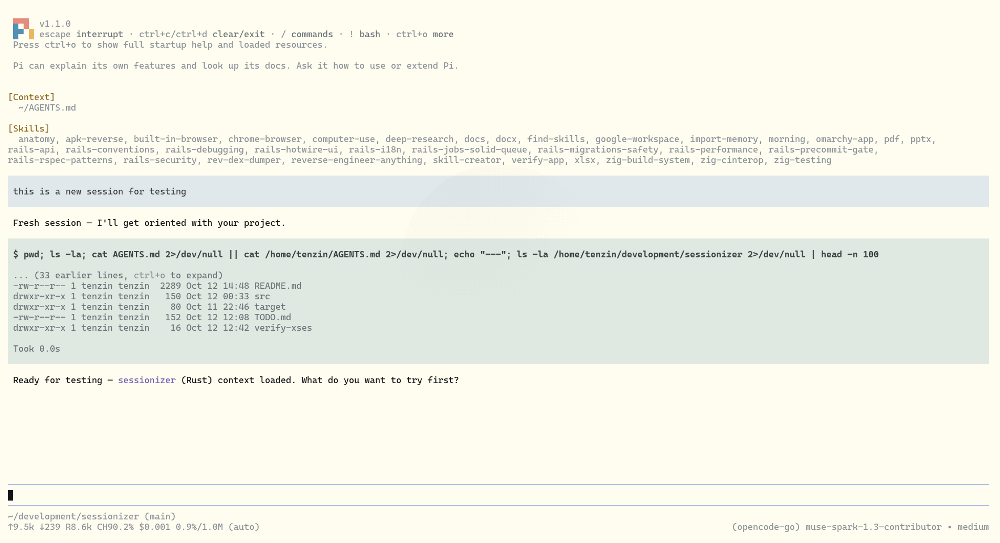
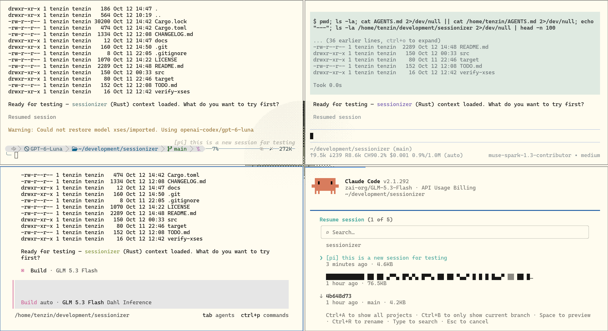

# xsession

`xsession` lets you find, resume, and share coding-agent sessions across
Claude Code, Codex, Pi, oh-my-pi, and OpenCode.



Sessions are scanned, normalized, synchronized, and made available through
one searchable view:



## Install

### Download a signed release

On Linux or macOS:

```sh
curl --proto '=https' --tlsv1.2 -fsSL \
  https://raw.githubusercontent.com/yesheytenzin/xses/main/install.sh | sh
```

The installer detects the platform, downloads the latest release, verifies
its SHA-256 checksum, and installs `xses` to `~/.local/bin`.

### Build from source

```sh
cargo install --path . --root "$HOME/.local"
```

The command is `xses`.

## Quick start

```sh
xses pick                # newest 5 sessions here; Enter resumes the chosen one
xses sync                # move the newest session from each agent
xses ls                  # newest 5 sessions in this project
xses clean               # remove the newest synced session's imports
xses doctor              # what is installed, what failed
```

`xses` on its own is `xses pick`.

## Commands

Every command works on the current project by default; `--all` widens it to
every project. `ls` and `pick` cap their list at the newest 5 unless `-n N`
changes it (`-n 0` = no cap).

### `xses pick` (also bare `xses`)

Opens the picker over the newest sessions; Enter resumes the chosen session in
the agent that owns it.

| Flag | Meaning |
|---|---|
| `-q, --query <TEXT>` | Start with a search query (fuzzy). |
| `--all` | Every session from every project. |
| `-n, --limit <N>` | Rows to list (0 = no cap). |

### `xses ls [TOOL]`

| Flag | Meaning |
|---|---|
| `--all` | Every project. |
| `--count` | Per-tool tallies for every project (store health). |
| `-n, --limit <N>` | Rows to list (0 = no cap). |

### `xses sync [ITEMS]`

Moves sessions between agent stores (and to trace formats). Tokens are either
destinations (tool names, `sharegpt`, `openai`) or session refs (`latest`,
`latest:N`, an id prefix).

| Flag | Meaning |
|---|---|
| `--from <TOOL\|REF>` | Source tools (`--from claude --from omp`) or explicit refs. |
| `--to <TOOL\|FORMAT>` | Destinations (`--to pi`, `--to openai`). |
| `--all` | Use sessions from every project. |
| `-n, --num <N>` | Newest N sessions per source tool (default 1). |
| `--scope <N>` | Import only the trailing N turns of each session. |
| `--include-imports` | Also re-import files xses itself wrote. |
| `-o, --out <PATH>` | Output file for format targets (default stdout). |
| `--dry-run` | Plan and report fidelity without writing anything. |

```sh
xses sync                                # newest session of each agent -> every other agent
xses sync claude                         # newest session of every other agent -> claude
xses sync --from claude --to pi          # claude sessions -> pi
xses sync --from opencode --to codex     # any pair works
xses sync --to pi --dry-run              # preview, nothing written
xses sync latest --to claude              # one session by ref (ref-only = preview)
xses sync latest:3 --to codex             # the 3rd newest
xses sync --all --scope 20               # every session, last 20 turns each
xses sync --from claude sharegpt -o chat.json
```

A pair whose source is already the target (`--from omp --to omp`) is a no-op:
xses never imports a session into the tool that owns it, and it says so
instead of reporting a silent zero.

### `xses clean`

| Flag | Meaning |
|---|---|
| `--all` | Remove every session xses ever imported, in every project. |
| `--dry-run` | Report what would be removed. |

Without flags, `clean` removes the newest synced session of the current project
(every copy it made, in every target) and leaves every other import — and its
index records — untouched.

### `xses doctor`

Read-only health report: agent CLIs and `sqlite3` present, sessions per store,
how many imports the index records (including records whose artifacts are
gone), and the newest failures from the issue journal.

| Flag | Meaning |
|---|---|
| `--all` | Count sessions across every project. |
| `-n, --limit <N>` | Journal entries to show (default 10). |

## What it does

- Shows sessions from all supported agents in one searchable picker.
- Resumes a session in the agent that owns it.
- Imports sessions into other agents without modifying the source.
- Marks untransferable content (images, patches, redacted reasoning, lost tool
  output) with in-transcript `[gap in imported history: …]` markers, and counts
  it as `dropped` in the fidelity report.
- Labels flattened tool traffic as `transcript, not live`, so a resumed agent
  never mistakes past tool output for state it can continue.
- Skips empty sessions, and skips xses-made imports unless `--include-imports`.
- Avoids duplicate imports (idempotent per session content) and reports what
  survived each conversion.
- Retries opencode imports once, serialized, and journals what still fails.

Supported agents:

| Agent | Source | Resume command |
|---|---|---|
| Claude Code | `~/.claude/projects/**/*.jsonl` | `claude --resume ID` |
| Codex | `~/.codex/sessions/**/*.jsonl` + state db | `codex resume ID` |
| Pi | `~/.pi/agent/sessions/**/*.jsonl` | `pi --session ID` |
| oh-my-pi | `~/.omp/agent/sessions/**/*.jsonl` | `omp -r ID` |
| OpenCode | its local SQLite store | `opencode -s ID` |

Imports make the `[agent] title` prefix visible where each picker reads it, so
imported sessions stay identifiable in `claude --resume`, `codex resume`,
`pi -r`, `omp -r`, and `opencode`.

## How it works

1. **Scan** — each store is read into one session record per transcript; a
   per-file cache means an append costs one re-parse, not a full rescan.
2. **Extract** — transcripts parse into a typed intermediate representation
   (text, thinking, tool calls/results, compactions) with per-block fidelity.
   A corrupt or truncated record becomes a visible gap instead of failing the
   session.
3. **Write** — each target writer serializes that IR into its native format:
   Claude JSONL plus a `custom-title.json` sidecar, Codex rollouts plus the
   `threads` row and history projections, Pi/oh-my-pi v3 JSONL with a
   `session_info` name, OpenCode through `opencode import`.
4. **Record** — every (target, source) pair is fingerprinted in
   `index.jsonl`, which makes re-syncs idempotent and lets `clean` undo
   exactly what xses wrote.

## Where xses keeps state

| Path | Purpose |
|---|---|
| `~/.local/share/xses/index.jsonl` | Imported (target, source) pairs and their artifacts. |
| `~/.local/share/xses/scan-cache.json` | Per-file scan cache. |
| `~/.local/share/xses/issues.jsonl` | Failures reported by `doctor`. |
| `~/.local/share/xses/index.lock` | Held while syncing or cleaning. |

## Troubleshooting

- **A sync reports `fail …: no writer output`** — that target refused the
  session; run `xses doctor` to see the recorded reason (the OpenCode CLI's own
  message is kept verbatim).
- **`another xses sync or clean is still running`** — the index lock is held by
  a live process; xses removes stale locks itself.
- **OpenCode imports are slow** — `opencode import` costs ~1s of startup plus
  ~1.8s/MB of payload, so very large transcripts take a while; they run in
  parallel and retry once on a lost SQLite lock race. Steady-state syncs are
  seconds.
- **A resumed session shows `[gap in imported history: …]`** — the source held
  something that format cannot carry (an image, a patch, stripped reasoning);
  the marker is placed where the content was lost.

## Useful commands

```sh
xses pick -q "query" --all
xses ls --count
xses sync latest --to pi --dry-run
xses sync --from claude --to pi --scope 20
xses clean --dry-run
xses doctor -n 20
```

## License

MIT. See [LICENSE](LICENSE).
